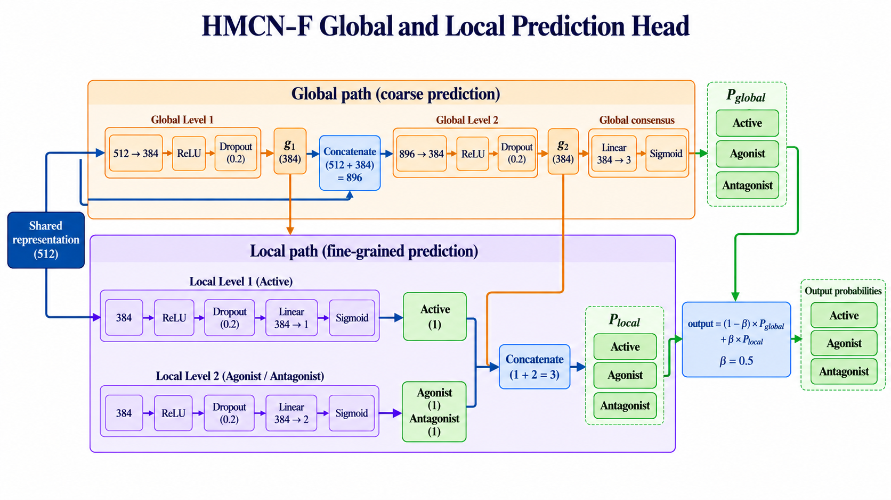
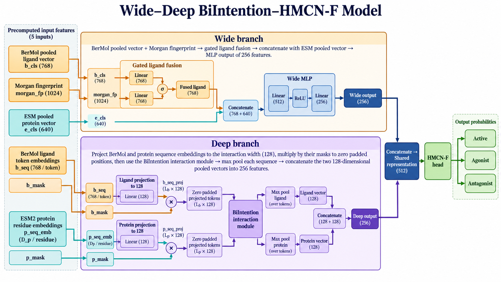
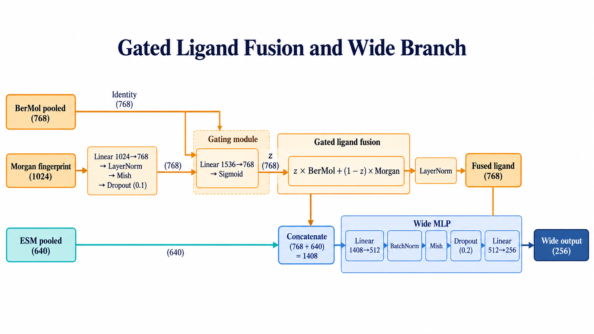
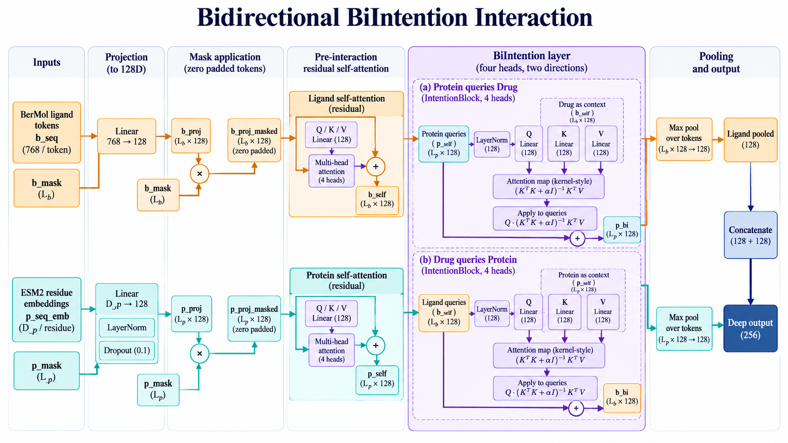

# HAGDTI_Ori

This folder contains a preserved copy of the original HAGDTI BerMol + Morgan + ESM model, with the training entry point aligned to the HMCN-F implementation in this folder.

## Module contract

- `model_bindti_concate_bermol_morgan_esm_hmcn.py` defines `WideDeepHMCNFModel` and returns three probabilities in `[Active, Agonist, Antagonist]` order.
- `train_bindti_bermol_concate_morgan_esm_moa.py` imports that class directly. It also exposes the BerMol, Morgan, ESM, and collation functions used by the inference-service adapter.
- The training loss consumes probabilities, applies positive-class weighting, and adds the existing parent-child consistency penalty. It does not apply a second sigmoid or `BCEWithLogitsLoss` to probability outputs.
- Raw labels are `0=inactive`, `1=agonist`, and `2=antagonist`; the trainer converts them to `[active, agonist, antagonist]` targets.
- Sequence masks are carried through self-attention, cross-sequence intention, and max pooling. The intention kernel uses a positive softplus-parameterized ridge value and a linear solve.
- Feature cache names include the cleaned dataset digest, the trainer source fingerprint, encoder/code paths and SHA-256 file-content fingerprints, feature dimensions, and extraction schema. The fingerprint reads each file in the configured encoder directories before cache reuse.

## Architecture diagrams

These diagrams document the `WideDeepHMCNFModel` implementation in this folder. They show the default feature dimensions where applicable; the ESM widths can be changed with the training CLI options described below.

### HMCN-F global and local prediction head



### Wide-Deep BiIntention-HMCN-F model



### Gated ligand fusion and wide branch



### Bidirectional BiIntention interaction



The model dimensions are explicit CLI parameters. Defaults match the model class defaults (`esm_dim=640`, `esm2_dim=2560`). For a serving configuration that uses a 2560-wide pooled ESM feature and a 320-wide sequence ESM feature, pass `--esm_dim 2560 --esm2_dim 320`. Use the same encoder checkpoints, dimensions, and preprocessing when training weights intended for a specific inference ensemble.

## Train

Run from the repository root after installing the dependencies in the root `requirements.txt` and providing the data, BerMol files/package, and local ESM checkpoints:

```powershell
python -m HAGDTI_Ori.train_bindti_bermol_concate_morgan_esm_moa `
  --data_path <dataset.tsv> `
  --bermol_path <BerMol-directory> `
  --esm_path <pooled-ESM-checkpoint> `
  --esm2_path <sequence-ESM-checkpoint> `
  --esm_dim 640 `
  --esm2_dim 2560
```

`--bermol_path` must contain the BerMol tokenizer package under `bermol/` and a supported, trusted local model file (`bermol_fixed.pt`, `BerMolModel.pkl`, or `BerMolModel_base.pkl`). BerMol artifacts and feature-cache pickle files are executable serialization formats: load only trusted local files and keep `--output_dir` under your control. The dataset must provide non-empty text `Protein` values and integer `Y` values in `{0, 1, 2}`; aliases `Smiles`, `Sequence`, and `Activity_Label` are normalized by the script. Conflicting labels for the same cleaned SMILES/protein pair stop the run. Feature caches and checkpoints are written under `--output_dir`.

For the service configuration described above, substitute the matching ESM paths and dimensions (`--esm_dim 2560 --esm2_dim 320`). The script validates cached feature widths before training and fails with a clear error if an encoder, CLI dimension, or cache does not match. `--batch_size` must be at least 2 because the wide branch uses `BatchNorm1d`; a final singleton training batch is dropped to avoid a normalization error.

## Scope and provenance

No training data, pretrained weights, BerMol package, or generated checkpoints are included. Original source files remain untouched at their source location. The copied model retains the HMCN architecture while adding padding-safe attention/pooling and stable intention-kernel solving; the trainer copy imports and trains `WideDeepHMCNFModel` directly.

Source SHA-256 before copying:

- Model: `799843AA3B7D450C50C34004B90E561ED7ED0EC57AEDAB9D29CC95A44E2CB5E9`
- Trainer: `00BB93146EE24B6C5AC0011C848D4BAEBC12B8E27CCABED87CDF465BDC8BA324`
