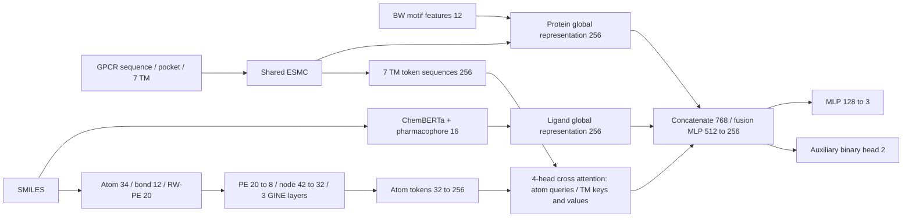

# HAGDTI-GINEP

独立整理的 **GIN-EP 完整模型架构**。来源为 `linhan666/GPCRDTI` 的 `abl_ax3_gin_ep` 实验：ESMC 蛋白分支、GPCR 先验、ChemBERTa/药效团配体分支、GINE + 键特征 + RW-PE 原子图分支、原子到 TM 的交叉注意力、flat fusion 和 MLP 三分类头。

本目录只提供该模型架构、必要特征函数和离线接口检查。完整实验调度、其他模型分支、数据、预训练权重和训练后检查点不在发布范围内。原项目源文件未修改。

## 固定架构



固定 `graph_deep_type=gin_ep`、`graph_use_edge_attr=True`、`graph_use_rw_pe=True`、`protein_token_source=tm7`、`fusion_mode=flat`、`head_type=mlp`。蛋白“全序列”输入用于全局 CLS 表示；交叉注意力的蛋白 token 来源固定为七个跨膜片段。

标签顺序：`0=inactive`、`1=agonist`、`2=inhibitor`。二分类辅助头使用 `0=inactive`、`1=active`；推理三分类概率为 `softmax(logits)`。

## 文件

| 文件 | 用途 |
|---|---|
| `ginep.py` | 固定 GIN-EP 配置及 `build_model` 入口 |
| `config.py` | 所需模型参数及预训练路径 |
| `model.py` | ESMC 加载、蛋白/配体编码、交叉注意力和完整模型 |
| `graph_deep_encoder.py` | 唯一图分支 GINE + bond + RW-PE |
| `ligand_graph.py` | 原子 34 维、键 12 维和 RW-PE 20 维 |
| `data.py` | 药效团特征和共享维度 |
| `heads.py` | MLP 分类头及三分类概率转换 |
| `tensor_utils.py` | 按图编号还原 padded 原子 token |
| `esmc_tokenizer.py` | 原项目 ESMC 分词器兼容层 |
| `tests/test_architecture.py` | 模拟骨干的完整前向/反向与图边界检查 |
| `ARCHITECTURE.md` | 数学路径、输入张量和接口说明 |
| `PROVENANCE.json` | 原始提交、源码哈希、提取范围 |

## 使用

建议在独立 Python 环境中安装 `requirements.txt`。PyTorch 应按实际 CPU/CUDA 环境安装；这里的依赖列表不是锁定的复现实验环境。

```bash
python -m pip install -r requirements.txt
python -B -X utf8 run_ginep.py
python -B -X utf8 -m unittest discover -s tests -v
```

上述配置打印和测试不下载预训练权重。测试通过模拟 ESMC/ChemBERTa 输出检查架构，不验证真实预训练模型或科学预测效果。

加载真实完整模型：

```python
from ginep import GINEPConfig, build_model
from heads import extract_3class_probs

cfg = GINEPConfig()
cfg.esmc_local_path = "/path/to/ESMC_300M"
cfg.ligand_encoder = "/path/to/ChemBERTa-zinc-base-v1"
model = build_model(cfg).eval()
# batch 张量按 ARCHITECTURE.md 准备，并与模型放在同一设备。
# output = model(batch)
# probabilities = extract_3class_probs(output)
```

默认 ESMC-300M 隐藏维度为 960；若使用 ESMC-600M，须同步设置 `esmc_model_size="600m"` 和 `protein_hidden=1152`。ChemBERTa 隐藏维度须与 `ligand_hidden=768` 对齐。

## 验证与边界

- 2026-10-14：两项离线测试通过；完整三分类/辅助二分类前向、注意力形状、概率归一化及各通路梯度均通过检查。
- 与原始 `abl_ax3_gin_ep` 对比：模拟骨干下 106 个 `state_dict` 键及初始化参数完全一致，严格检查点加载通过，所有前向输出张量逐位一致。该检查不涉及真实预训练权重。
- 原始数据行为保留：非法或空 SMILES 会生成占位图；缺失键属性或 RW-PE 会使用零值降级。正式推理前应校验输入，不能把占位图当作有效化学结构。
- 训练模式的 BatchNorm 需要足够的节点样本；单原子单样本批次可能报错。推理应使用 `model.eval()`。
- TM token mask 保留原始分词器口径；没有新增残基筛选或口袋结构推断。默认长度限制可能截断序列，GPCRdb 片段和 motif 特征需由调用者提供。
- 结果表、论文中的性能主张和其他实验版本未纳入本架构发布。

本仓库未自行增加开源许可证；使用、分发及预训练模型许可需依据原项目和相应模型条款。
