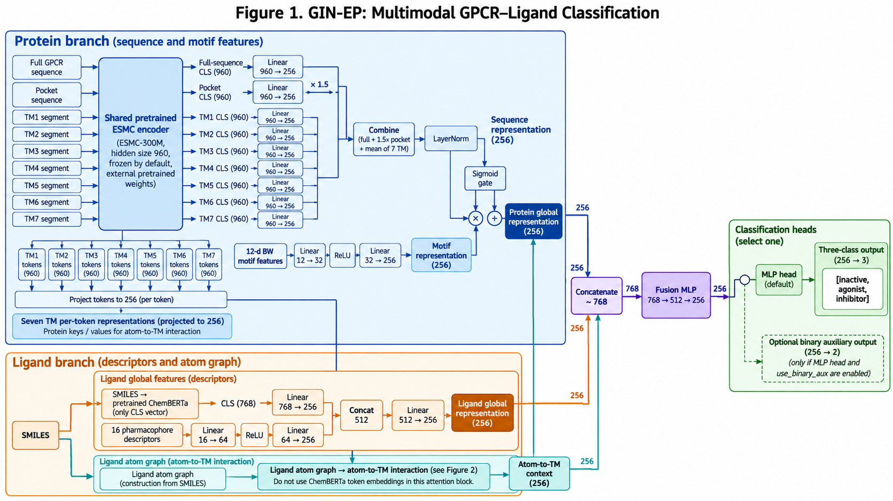
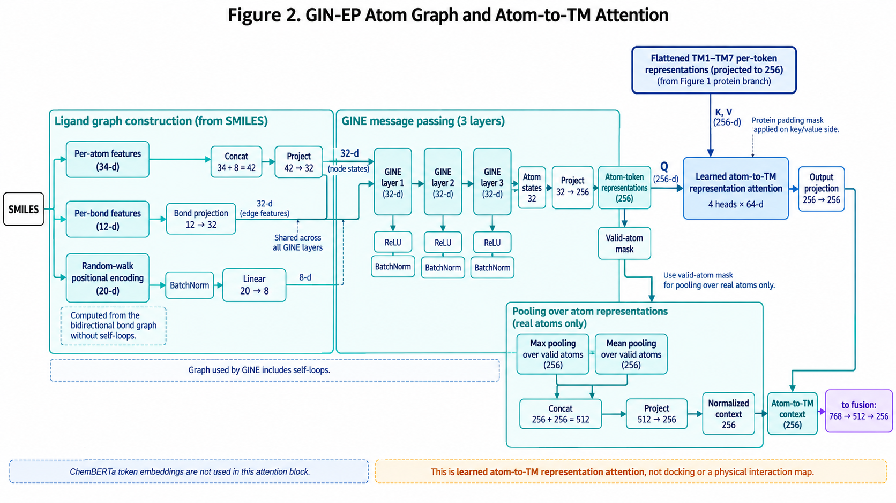
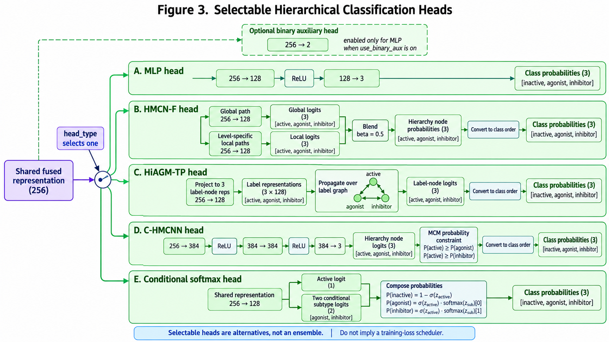

# HAGDTI-GINEP

**GIN-EP 药物–靶点相互作用模型**包含ESMC 蛋白分支、GPCR 先验、药效团配体、GINE + 键特征 + RW-PE 原子图分支、原子到 TM 的交叉注意力、flat fusion，以及 MLP、HMCN-F、HiAGM-TP、C-HMCNN 和 conditional-softmax 五种可选分类头。

仓库包含模型实现、特征函数、接口测试和使用说明。训练数据、预训练权重及训练后检查点需自行提供。分子生成模型位于 [`model_gen_comparison`](model_gen_comparison/README.md)。

## 模型示意图

### 图 1：GIN-EP 整体架构

### 图 2：原子图与原子到 TM 的注意力

### 图 3：可选分类头

## 模型配置

固定 `graph_deep_type=gin_ep`、`graph_use_edge_attr=True`、`graph_use_rw_pe=True`、`protein_token_source=tm7`、`fusion_mode=flat`。分类头默认 `mlp`，可切换为下表中的其他头。蛋白“全序列”输入用于全局 CLS 表示；交叉注意力的蛋白 token 来源固定为七个跨膜片段。

标签顺序：`0=inactive`、`1=agonist`、`2=inhibitor`。二分类辅助头使用 `0=inactive`、`1=active`；MLP 推理概率为 `softmax(logits)`；层级头和条件头请统一使用 `extract_3class_probs(output)`，不能直接对其 `logits` 使用三分类 softmax。

## 可选分类头

五种头共用同一 GIN-EP 编码与融合骨干；`cfg.head_type` 只切换预测头。各头实现、参数默认值和概率解释沿用原项目。

| `head_type` | 分类头 | 原始输出语义 | 训练损失口径 |
|---|---|---|---|
| `mlp` | MLP | `[inactive, agonist, inhibitor]` 三分类 logits | 三分类交叉熵；可加独立 active/inactive 辅助交叉熵 |
| `hmcnf` | HMCN-F | `[active, agonist, inhibitor]` 层级节点 logits，全局/局部流融合 | 层级标签 BCEWithLogits |
| `hiagm` | HiAGM-TP | `[active, agonist, inhibitor]` 标签图节点 logits | 层级标签 BCEWithLogits |
| `chmcnn` | C-HMCNN | 层级节点 logits，推理经 sigmoid 和 MCM 约束 | `chmcnn_mc_loss`；`chmcnn_mcm` 保证 parent 概率不小于 child |
| `cond_softmax` | Conditional softmax | `active_logit [B]` 和 `cond_logits [B,2]` | active BCEWithLogits；active 样本上的 agonist/inhibitor 交叉熵 |

HMCN-F 默认 `hierarchy=[1,2]`、`hidden_dim=384`、`beta=0.5`；HiAGM-TP 默认 `node_dim=128`；C-HMCNN 使用 `hmcnf_hidden_dim=384`；conditional-softmax 使用 `mlp_head_hidden_dim=128`。独立的 `binary_logits` 仅 MLP 且 `use_binary_aux=True` 时输出；其余头已有 active 节点或 active logit。

层级标签按 `get_hier_labels(labels)` 转换为 `[active, agonist, inhibitor]`。统一概率始终按 `[inactive, agonist, inhibitor]` 返回；HMCN-F/HiAGM-TP 使用层级条件分解，C-HMCNN 先做 MCM 后分解，conditional-softmax 使用 `P(active) * P(subtype | active)`。本仓库提供头与必要函数，训练损失调度和原项目的完整训练流程仍由调用方实现。

## 文件

| 文件 | 用途 |
|---|---|
| `ginep.py` | 固定 GIN-EP 配置及 `build_model` 入口 |
| `config.py` | 所需模型参数及预训练路径 |
| `model.py` | ESMC 加载、蛋白/配体编码、交叉注意力和完整模型 |
| `graph_deep_encoder.py` | 唯一图分支 GINE + bond + RW-PE |
| `ligand_graph.py` | 原子 34 维、键 12 维和 RW-PE 20 维 |
| `data.py` | 药效团特征和共享维度 |
| `heads.py` | 五种分类头、层级标签、C-HMCNN 约束/损失及统一三分类概率转换 |
| `tensor_utils.py` | 按图编号还原 padded 原子 token |
| `esmc_tokenizer.py` | 原项目 ESMC 分词器兼容层 |
| `tests/test_architecture.py` | 模拟骨干的完整前向/反向与图边界检查 |
| `ARCHITECTURE.md` | 数学路径、输入张量和接口说明 |

本仓库未自行增加开源许可证；使用、分发及预训练模型许可需依据原项目和相应模型条款。
