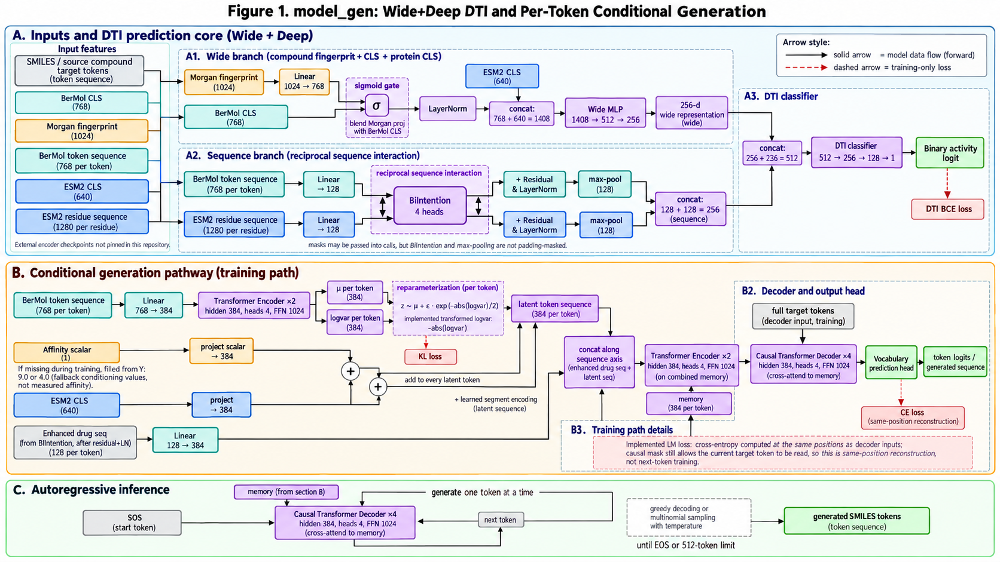
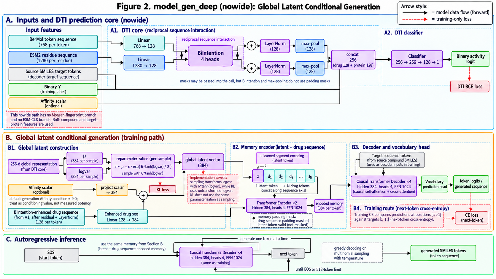

# Molecular generation models

本目录包含两个分子生成模型及其训练入口：`model_gen` 和 `model_gen_deep`。模型实现来自 [HAGDTIGen](https://github.com/linhan666/HAGDTIGen)。

图片展示模型结构，图中的旧训练注释不适用于当前实现；训练目标、padding mask 和 KL 规则见各模型说明。

## model_gen



模型文件：[`model_gen/model_gen.py`](model_gen/model_gen.py)。训练入口：[`model_gen/train_gen.py`](model_gen/train_gen.py)。SMILES 分词、词表和数据辅助函数位于 [`model_gen/utils.py`](model_gen/utils.py)。

模型包括药物–靶点预测和条件分子生成两个任务。`WideDeepModel_Core` 使用 BerMol CLS、Morgan 指纹及 ESM CLS 构建全局表示，同时通过 BiIntention 处理 BerMol token 和 ESM residue 表示。分类器使用融合表示预测二分类活性。

生成模块将 BerMol 序列投影至 384 维，经两层 Transformer 编码后产生逐 token 的潜变量。亲和力条件和 ESM CLS 注入潜变量，与药物序列共同构成生成 memory。Decoder 使用四层 Transformer，隐藏维度 384、四个注意力头、前馈维度 1024。

训练需要 SMILES、Protein、Y，以及可选的 Affinity 字段；还需 BerMol 模型目录、ESM CLS 和 ESM sequence 模型目录。默认 batch size 为 128、训练 50 epochs、学习率 `1e-4`，按验证 DTI AUC 保存检查点。

```bash
cd model_gen
python train_gen.py --data_path /path/data.csv --output_dir /path/output --bermol_path /path/bermol --esm_cls_path /path/esm_cls --esm_seq_path /path/esm_seq
```

训练使用位置 t 的输出预测 t+1 的目标 token，并忽略 padding 标签。有效位置 mask 同时用于双向序列交互、全局 max pooling 和 decoder；KL 只累计有效药物 token，并按实际 batch size 取平均。

## model_gen_deep



模型文件：[`model_gen_deep/model_gen_deep.py`](model_gen_deep/model_gen_deep.py)。训练入口：[`model_gen_deep/train_gen_deep.py`](model_gen_deep/train_gen_deep.py) 或 [`model_gen_deep/train_gen_deep_nowide.py`](model_gen_deep/train_gen_deep_nowide.py)。SMILES 分词、词表和数据辅助函数位于 [`model_gen_deep/utils.py`](model_gen_deep/utils.py)。

`DeepModel_Core` 将 BerMol token 和 ESM residue 投影至 128 维，经 BiIntention 交互后分别池化，形成 256 维全局表示并预测二分类活性。全局表示用于生成一个 384 维潜变量；亲和力条件注入潜变量后，与药物序列一起输入生成模块。Decoder 使用四层 Transformer，隐藏维度 384、四个注意力头、前馈维度 1024。

训练需要 SMILES、Protein、Y，以及可选的 Affinity 字段；还需 BerMol 和 ESM sequence 模型目录。两个入口共用同一训练流程，默认 batch size 为 128、训练 50 epochs、学习率 `1e-4`。

```bash
cd model_gen_deep
python train_gen_deep_nowide.py --data_path /path/data.csv --output_dir /path/output --bermol_path /path/bermol --esm_seq_path /path/esm_seq
```

生成目标采用下一 token 交叉熵。采样与 KL 计算共同使用 `6 * tanh(raw_logvar)`，确保两者对应同一高斯分布；有效位置 mask 同时用于序列交互、全局 max pooling 和 decoder。两个训练入口只向模型传入 `tokenizer`、`bermol_dim` 和 `esm_seq_dim`；`train_gen_deep.py` 兼容旧命令中的 `--esm_cls_path` 和 `--morgan_dim`，模型不消费这些额外特征。

## 环境与输入

依赖列表见 [`requirements.txt`](requirements.txt)，不包含完整环境锁定。BerMol Python 包及预训练文件、ESM 权重、训练数据和缓存需另行提供。

训练表的 `Y` 为二分类标签。脚本接受 `SMILES`、`Protein`、`Y` 和可选的 `Affinity`，并支持 `Smiles`、`Sequence`、`Activity_Label`、`affinity` 列名映射。未提供 Affinity 时，脚本根据标签填入 9.0 或 4.0；这些值是构造条件，不是实测亲和力。
